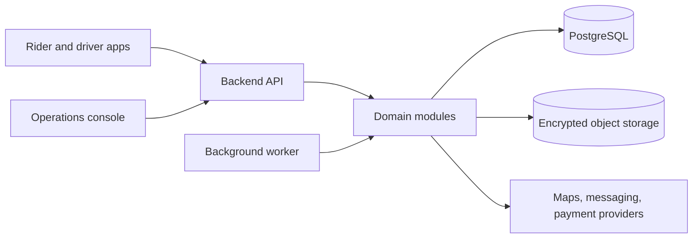
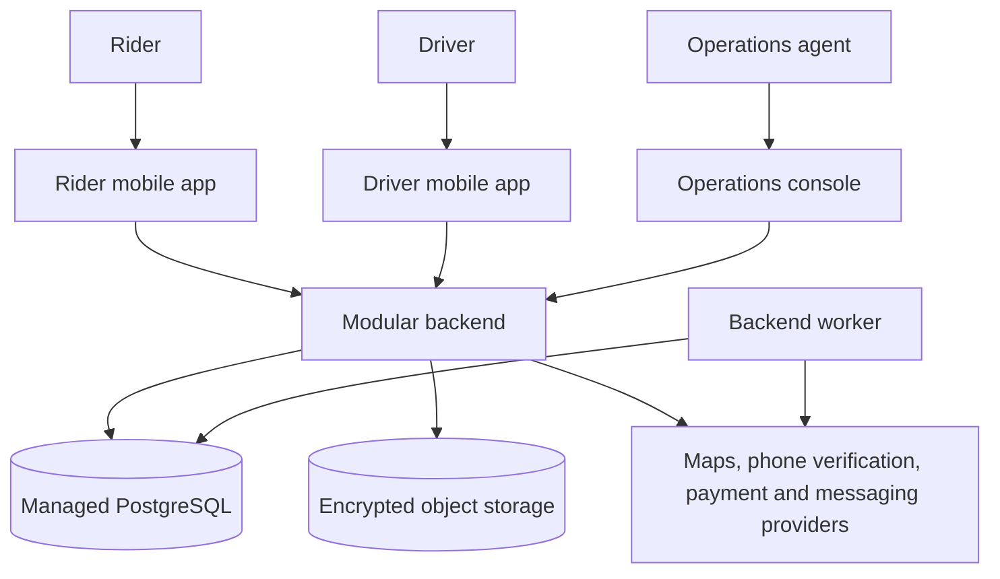
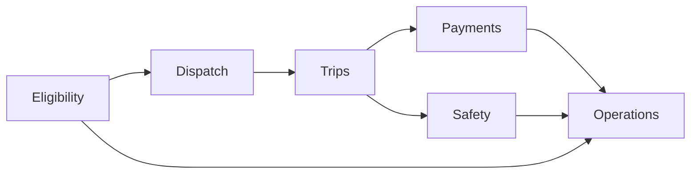

# Architecture Spine — Ride-hailing MVP

## Design Paradigm

A modular monolith. Rider app, driver app and operations console are clients of one domain backend. Modules own their domain state and communicate through typed commands and events. Only the backend writes durable trip, eligibility and payment state.

## Invariants & Rules

### AD-1 — Dispatch claims one trip and driver atomically

- **Binds:** FR3, FR4, Stories 2.4–2.5
- **Prevents:** Competing offers assigning a trip twice or one driver taking concurrent trips.
- **Rule:** Eligibility owns online and available status, including transitions to busy and back to available. Dispatch validates eligibility and synchronously locks the driver's current availability row, live offer and searching trip, then claims the trip and driver in one PostgreSQL transaction. Assignment makes the driver busy. Releasing an assignment returns the driver to online-available only if the driver remains online and eligible. The first valid commit wins regardless of client clocks. Enforce one active assignment per trip and driver. A replay of the winning request returns its recorded assignment. Losing drivers receive Trip taken and remain available.

### AD-2 — Money movements use durable idempotent operations

- **Binds:** FR7, FR13, Stories 3.7, 4.2
- **Prevents:** Lost or duplicate authorizations, captures, refunds or payouts after retry or uncertain provider response.
- **Rule:** Payments owns authorization, release, capture, refund, payout, ledger and reconciliation state. Trips owns completion and is the transaction coordinator: its transaction-scoped Payments operation inserts the capture request atomically with Completed. Each module writes only its own records. Persist money-movement intents with a stable provider operation identity and ledger reference. Workers reconcile unknown outcomes with the provider before retrying. Deduplicate callbacks and ledger entries. Never issue a payout again while its prior outcome is unknown. Authenticate provider callbacks before processing. Confirmed capture failure preserves Completed and creates a recoverable balance.

### AD-3 — Trip mutations use versioned idempotent commands

- **Binds:** FR2, FR5, FR6, trip lifecycle and reconnect behavior
- **Prevents:** Stale clients overwriting newer trip state or retries repeating transitions.
- **Rule:** Commands carry a unique request ID and observed server trip version. Return a recorded result for a replay in the same authorized actor and trip scope. For a new command, validate version and allowed transition, then atomically store transition, version increment and command outcome. A stale command has no side effects and requires state refresh before new intent.

### AD-4 — Location samples are ordered separately from trip state

- **Binds:** FR5, Story 3.2, NFR2
- **Prevents:** GPS traffic invalidating trip actions or old positions appearing current.
- **Rule:** Tracking owns latest-location state and its write API. Each active assignment has a server-issued tracking epoch. Drivers submit a monotonically increasing sequence within that epoch. Accept only a higher sequence for the current assignment and epoch; equal or lower sequences cannot replace position or refresh freshness. Use server receive time of the accepted sample for the 30-second staleness threshold. Reject buffered samples from a prior epoch. Location updates do not increment trip version.

### AD-5 — API and worker share one transactional backend

- **Binds:** All epics
- **Prevents:** Cross-service transactions for assignment and payment handoff during the pilot.
- **Rule:** Build one modular backend and one PostgreSQL system of record. Run the API and background worker as independently runnable processes from the same codebase. Use durable database-backed work records for payment capture and reconciliation.

### AD-6 — Mobile clients use Expo and React Native

- **Binds:** Rider and driver app surfaces
- **Prevents:** Independently chosen mobile stacks and incompatible shared client contracts.
- **Rule:** Build separate rider and driver applications with Expo, React Native and TypeScript. Share typed API contracts and accessible primitives while retaining distinct app navigation and permissions. Use native location capabilities for driver tracking and validate background behavior on supported iOS and Android devices.

### AD-7 — Backend modules own their state

- **Binds:** All epics
- **Prevents:** Clients or multiple modules becoming competing writers for shared trip and money state.
- **Rule:** Eligibility owns driver approval, suspension and online/available status. Dispatch owns offers and assignment. Trips owns lifecycle transitions. Payments owns authorizations, captures, refunds, payouts, ledger and reconciliation. Tracking owns location ingestion. Safety owns reports and escalation. Operations owns scoped administrative commands, zone pause and audit. Cross-module effects use typed commands and events. Use a transactional outbox when an event must survive a commit.

### AD-8 — Sensitive data access is authorized and auditable

- **Binds:** FR3, FR5, FR9, NFR3, NFR5
- **Prevents:** Analytics, clients or unauthorized roles exposing identity documents, payment details or unnecessary precise location.
- **Rule:** Store document blobs in encrypted object storage and persist references and review metadata in PostgreSQL. The backend authenticates actors, derives role claims from authenticated identity and checks authorization in the owning module. Serve documents only through short-lived backend-authorized access and audit reads and access-changing actions. Authenticate provider callbacks before changing state. Never put document contents, payment credentials, PINs or raw location in analytics. Limit precise location to active-trip uses. Agree market retention and deletion rules before launch.

### AD-9 — Domain modules own writes and transaction seams

- **Binds:** All epics
- **Prevents:** Modules mutating another domain's records or disagreeing which module coordinates an invariant-spanning operation.
- **Rule:** Each module exposes typed operations and mutates only its own records. Trips coordinates completion and invokes the transaction-scoped Payments capture-request operation. Dispatch reads and locks eligibility-owned availability within the assignment transaction. Tracking alone accepts location samples and owns their ordering and freshness. No client or module writes another module's tables directly.

### AD-10 — OpenAPI is the shared client contract

- **Binds:** All client/API stories
- **Prevents:** Rider app, driver app, console and backend adopting incompatible request, state or error shapes.
- **Rule:** Backend-owned OpenAPI definitions are the source of truth for HTTP contracts. Generate or validate client types from the contract in CI. Breaking changes require an explicit API version change and coordinated clients.

### AD-11 — Zone pause and operational recovery preserve active trips

- **Binds:** FR14, FR15, NFR1, NFR5
- **Prevents:** Booking pause interrupting active trips or worker/database incidents silently losing money-movement work.
- **Rule:** Operations owns a server-side zone booking gate checked at confirmation. Changing the gate blocks new requests only. Active trips continue. API and worker expose health and alerts for dispatch failures, stale-location spikes, delayed callbacks and reconciliation discrepancies. Durable work retries with bounded backoff and an inspectable terminal-failure queue. The database operator owns backups and a restore procedure tested before pilot.

### Dependency direction

## Consistency Conventions

| Concern | Convention |
| --- | --- |
| Naming | Stable domain IDs for trips, drivers, riders, documents and payment operations. Typed commands use action names; events use completed past-tense names. |
| Data & formats | Server timestamps in UTC; currency paired with integer minor-unit amounts and currency code. OpenAPI is canonical; clients use generated or validated types. Never trust client clock for ordering. |
| State & cross-cutting | PostgreSQL owns durable state. Validate authenticated role and transition at API boundary and in owning module. Idempotency keys are scoped by actor, operation and resource. Reusing a key with a different request fingerprint is rejected. Retain financial operation identities for reconciliation. Correlate logs by trip ID without sensitive payloads. |

## Stack

| Name | Version |
| --- | --- |
| Expo SDK | 58 |
| React Native | 0.88 |
| TypeScript | 5.9.x (repository range: ~5.9.3) |
| NestJS | 12 |
| Node.js | 22.13+ |
| PostgreSQL | 18.7 |

## Structural Seed

### System context

### Deployment and environments

Use managed container hosting for API and worker processes, managed PostgreSQL and encrypted object storage. Keep development, test and production data and credentials isolated. Alert ownership follows the module owning each signal. Select provider and region after launch market, data residency and team operations constraints are confirmed. No cloud account or provider is selected by this spine.

### Domain ownership

## Capability → Architecture Map

| Capability / Area | Lives in | Governed by |
| --- | --- | --- |
| Sign-in and driver documents | Mobile apps; backend identity boundary; Eligibility; encrypted object storage | AD-7, AD-8, AD-9 |
| Quote, booking, dispatch and availability | Rider app; Quotes, Eligibility and Dispatch | AD-1, AD-3, AD-5, AD-9 |
| Pickup PIN and trip lifecycle | Rider/driver apps; Trips; audited Operations commands | AD-3, AD-8, AD-9 |
| Live tracking and expiring trip share | Mobile apps; Tracking and Safety | AD-4, AD-8, AD-9 |
| Fares, authorization, capture, refunds, payouts and reconciliation | Trips and Payments; PostgreSQL; background worker | AD-2, AD-5, AD-7, AD-9 |
| Ratings, trip history, support and incident reports | Apps; Trips, Safety and Operations | AD-7, AD-8 |
| Zone pause, pilot events, metrics and operational alerts | Operations; owning modules; reporting views | AD-9, AD-11 |

## Deferred

- Cloud provider, region, data-residency implementation and production environment topology until market and operator constraints are confirmed.
- Exact maps, phone verification, payment, messaging and driver-document providers until market and procurement decisions.
- Exact TypeScript patch version and Expo-compatible React Native package versions at scaffold. Expo’s SDK compatibility matrix governs the selected React Native and native module versions.
- PostgreSQL 18 is the initial pilot major to favor a supported release branch over adopting PostgreSQL 19 immediately after release. Reassess against managed-provider support before scaffold.
- Specific database schema, API endpoint shapes, queues and source tree. Implement only as required by stories.
- City-specific document checklist, cancellation fees, no-show grace, quote guarantees, payout cadence, emergency routing and response staffing remain product/operations decisions.
- Background location frequency and battery tradeoffs require iOS and Android field tests against the PRD’s 10-second visibility target.
